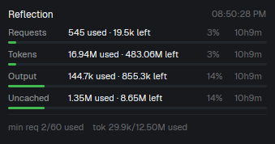

# herdr-reflection-usage



A [Herdr](https://github.com/) mod + helper script that shows your
[Reflection AI](https://platform.reflection.ai/) rate-limit / usage status
live in the Herdr window.

It polls Reflection's chat completions endpoint (one minimal request per
minute) and displays:

- requests remaining (per minute / per day)
- tokens remaining (per minute / per day)
- output tokens remaining (per day)
- uncached input tokens remaining (per day)
- reset timers for each

## Files

- `mod.json` + `main.js` — the Herdr mod (place in `~/.config/herdr-app/mods/reflection-usage/`)
- `reflection-usage` — helper script that fetches and prints the limits as JSON (install on your `PATH`)

## Install

1. Install the helper script somewhere on your `PATH`:

   ```sh
   cp reflection-usage ~/.local/bin/reflection-usage
   chmod +x ~/.local/bin/reflection-usage
   ```

2. Provide your Reflection API key (one of):

   - environment variable: `export REFLECTION_API_KEY=...`
   - file: `~/.config/reflection-usage/api_key` (first line)

   ```sh
   mkdir -p ~/.config/reflection-usage
   printf '%s\n' "$REFLECTION_API_KEY" > ~/.config/reflection-usage/api_key
   chmod 600 ~/.config/reflection-usage/api_key
   ```

3. Install the mod:

   ```sh
   mkdir -p ~/.config/herdr-app/mods/reflection-usage
   cp mod.json main.js ~/.config/herdr-app/mods/reflection-usage/
   ```

4. Verify it loads:

   ```sh
   herdr-app check ~/.config/herdr-app/mods/reflection-usage
   ```

5. Open it in Herdr, e.g. as a tab:

   ```sh
   herdr-app do tab.new --mod reflection-usage --name "Reflection usage"
   ```

   Or keep it always visible by adding it to a layout clone.

## Notes

- Each poll makes one chat completion request with `max_tokens: 1`, so it
  consumes a small amount of your daily request/token allowance.
- Default poll interval is 60 seconds (edit `cx.sleep(60000)` in `main.js`).
- The mod uses `exec("reflection-usage", [])`, so the script must be on the
  Herdr process's `PATH`.

## License

Reflection Usage License 1.0: AGPL-3.0 plus an additional commercial-size
restriction. Individuals and organizations with 100 or fewer employees and
under USD 1M annual revenue may use it commercially; larger organizations
need a separate commercial license. Derived works must use the same license.
Includes the AGPL-3.0 patent grant. See `LICENSE`.